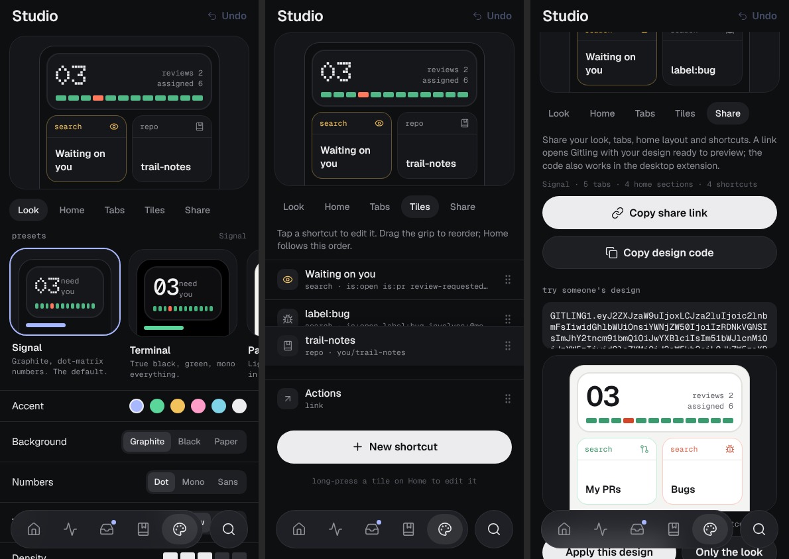

<div align="center">


# Gitling

**The GitHub client you design yourself.**<br>
A phone app for your repos, inbox and pull requests, and a browser extension that puts the same look on github.com.

[](https://github.com/vassu-v/gh-restyle/actions/workflows/ci.yml)
[](https://gitling.truckcoding.workers.dev)


**[Try it now](https://gitling.truckcoding.workers.dev)** &nbsp;·&nbsp; no account needed, it opens with sample data

<br>



</div>

> [!NOTE]
> Gitling is an independent app that uses the GitHub API. It is not made or endorsed by GitHub.

## What you get

- **Your layout, not ours.** Studio lets you pick a preset (Signal, Terminal, Paper, Dense, Calm, Ink), then change the accent, background, number style, density, text size, tab bar, Home sections and shortcut tiles that open any search, repo or link. Undo included.
- **Designs you can share.** Send a `GITLING1.` code, a share link that previews before applying, or a readable [`.gitling.json` file](docs/DESIGN-FILE.md).
- **Real GitHub work on a phone.** Feed, inbox triage, repos and a code browser with syntax colors, issues, and pull requests with diffs, checks, merge and full reviews (line comments, suggestions, approve or request changes).
- **Feels like an app.** Install it to your home screen, open it offline, and land on your saved data instead of a spinner. A short welcome tour sets up your look on first launch.
- **The same look on desktop.** The extension restyles github.com and gist.github.com with your design. It uses your existing GitHub session and needs no sign-in.
- **Private by default.** Sign in with GitHub (OAuth + PKCE) or paste a token. The token stays on your device, encrypted on the web, and only goes to api.github.com. The Worker stores nothing.

## Quick start

Needs Node.js 20+.

```bash
npm install
npm run web      # dev server with sample data, every screen works signed out
```

To use your own account: set up one-tap sign-in once with [`docs/SETUP-SIGNIN.md`](docs/SETUP-SIGNIN.md), or go to avatar → Account → **Use a personal access token instead** (classic token with `repo`, `notifications`, `read:user`). On a phone during development, scan the QR code from `npx expo start` in `apps/app` with Expo Go.

Before calling anything done, run `npm run check` (types, lint, unit tests, both builds). `npm run verify` runs the whole local suite: smoke test of every screen plus the sign-in, Studio, review and onboarding end-to-end runs.

## Desktop extension

1. `npm run build:extension`
2. Open `chrome://extensions`, turn on **Developer mode**, click **Load unpacked** and pick `apps/extension/dist`.
3. Open github.com. Use the Gitling icon to switch background or counter style, or paste a design from the app (Studio → Share).

<!-- Screenshot to add: github.com repo page with the extension on, side by side in Paper (light) and Graphite (dark), plus the popup. -->

It isn't on the Chrome Web Store yet. Only Chrome is tested; see [`docs/EXTENSION.md`](docs/EXTENSION.md) for every control and the known limits.

## Deploy

`npm run deploy` builds the app and ships one Cloudflare Worker that serves both the app and the sign-in routes ([`docs/DEPLOY.md`](docs/DEPLOY.md)). `npm run deploy:preview` uploads a branch preview without touching the live site. On the phone, open the URL and use Account → **Install app** (Android, Chrome) or Share → **Add to Home Screen** (iPhone).

## How it's built

```
apps/app/          Expo Router + React Native Web: the app and the PWA
apps/extension/    Manifest V3 extension that restyles github.com
packages/github/   typed GitHub REST client, OAuth/PKCE, sample data
packages/design/   design schema, presets, share codes, contrast fitting
services/edge/     Cloudflare Worker: static app + OAuth code exchange
scripts/           PWA post-build, smoke and end-to-end runs, deploy
```

## Read more

| | |
|---|---|
| [`AGENTS.md`](AGENTS.md) | Start here if you're contributing or you're an AI agent: rules and every command |
| [`docs/STATUS.md`](docs/STATUS.md) | What's done, how it was verified, and what isn't yet |
| [`docs/ARCHITECTURE.md`](docs/ARCHITECTURE.md) | How it fits together; [`docs/decisions/`](docs/decisions/) explains why |
| [`docs/TESTING.md`](docs/TESTING.md) | Test layers and when to run what |
| [`PLAN.md`](PLAN.md) | Milestones and what's next (push notifications, design sync, store builds) |
